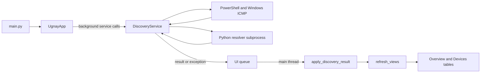

# Module 1: Network Discovery

UGNAY LAN Health Checker — user and developer documentation.

Documentation reviewed: **17 November 2026**. This document describes the
implementation in the current working tree, including its operational limits.

## Contents

1. [Purpose and scope](#1-purpose-and-scope)
2. [Requirements and startup](#2-requirements-and-startup)
3. [Using the interface](#3-using-the-interface)
4. [Files and responsibilities](#4-files-and-responsibilities)
5. [Architecture and threading](#5-architecture-and-threading)
6. [Network detection](#6-network-detection)
7. [Device discovery](#7-device-discovery)
8. [Hostname lookup and device records](#8-hostname-lookup-and-device-records)
9. [Data contracts](#9-data-contracts)
10. [Service API and configuration](#10-service-api-and-configuration)
11. [UI integration and state](#11-ui-integration-and-state)
12. [Errors and empty results](#12-errors-and-empty-results)
13. [Verification and recorded results](#13-verification-and-recorded-results)
14. [Troubleshooting](#14-troubleshooting)
15. [Limitations and maintenance](#15-limitations-and-maintenance)

## 1. Purpose and scope

Module 1 identifies the local IPv4 network and builds a snapshot of devices that
respond to ICMP echo requests. It supplies device records to the Overview and
Devices screens and makes those records available to the other modules.

| Requirement | Implemented behavior |
| --- | --- |
| Detect the local address | Read connected Windows adapter configuration. |
| Determine the subnet | Calculate CIDR from the actual IPv4 prefix. |
| Discover devices | Probe usable addresses with a bounded worker pool. |
| Retrieve names | Perform optional reverse lookup after a successful response. |
| Build device records | Include address, optional name, observation time, and an untested result. |
| Present results | Update both device tables, network details, count, timestamp, and selection. |
| Handle no responders | Return an empty tuple and display an empty result. |
| Handle failures | Raise an exception and retain the previous successful UI snapshot. |

Discovery establishes that an address responded at the time of the scan. Detailed
ping measurements, latency statistics, packet-loss calculations, and connectivity
statuses belong to Module 2. Reports, recommendations, and export belong to
Module 3; those services remain stubs in this version.

## 2. Requirements and startup

| Requirement | Details |
| --- | --- |
| Operating system | Windows for the current discovery implementation. |
| Python | Python 3.10 or newer; the earlier verified environment used Python 3.14.0. |
| GUI | Tkinter and a graphical desktop session. |
| Adapter detection | Windows PowerShell, available as `powershell.exe`, with NetTCPIP. |
| ICMP backend | `System.Net.NetworkInformation.Ping` through Windows PowerShell. |
| Permissions | Permission to execute PowerShell and read local adapter/CIM configuration. |
| Network | A connected IPv4 interface; internet access is not required for detection. |
| Dependencies | Python standard library and Windows components; no pip packages. |

Keep `main.py`, `ugnay/`, and `icons/` together. Missing icons fall back to text
controls. To check Python and Tkinter, run:

```powershell
python --version
python -m tkinter
```

Launch from the repository root:

```powershell
python main.py
```

The entry point explicitly uses:

```python
UgnayApp(demo=False).mainloop()
```

`UgnayApp()` also defaults to `demo=False`. Startup leaves the network undetected,
loads zero devices and reports, and prompts the user to scan. Detection and probes
begin only after **Scan Network** is invoked.

For the optional sample-data presentation:

```python
from ugnay.app import UgnayApp

UgnayApp(demo=True).mainloop()
```

Sample fixtures are presentation data, independent of the actual network.

## 3. Using the interface

1. Start the application. Confirm that Local IP and Network range show
   `Not detected`, Devices detected shows `0`, and Last scan shows `Never`.
2. Click **Scan Network**. The progress indicator runs and action buttons are
   disabled. The sidebar remains available for navigating between screens.
3. Wait for completion. Scan duration depends on range size, process startup,
   ICMP response time, hostname resolution, and machine load.
4. Inspect the Overview and Devices tables. They share the same device snapshot.
5. Select a device. Its name, address, last-seen time, and test status appear in
   the detail areas and device selector.
6. Scan again to refresh the snapshot. Rows are replaced rather than appended.

Newly discovered devices show `Not tested`. Their latency and packet-loss fields
have no measurements yet. `Hostname unavailable` is a valid display value and
does not invalidate discovery.

## 4. Files and responsibilities

Paths in this table are relative to the repository root.

| File | Module 1 responsibility |
| --- | --- |
| [main.py](../main.py) | Start the application in real-data mode. |
| [ugnay/discovery.py](../ugnay/discovery.py) | Network detection, scan validation, ICMP probes, hostname lookup, aggregation, and service exceptions. |
| [ugnay/models.py](../ugnay/models.py) | Shared immutable `NetworkInfo`, `Device`, and `DiscoveryResult` contracts. |
| [ugnay/app.py](../ugnay/app.py) | Scan event, background task, UI queue, application state, rendering, and dialogs. |
| [ugnay/widgets.py](../ugnay/widgets.py) | `DeviceTable`, reusable presentation components, and shared empty-result wording. |
| [ugnay/demo_data.py](../ugnay/demo_data.py) | Explicit sample-mode fixtures. |
| `tests/test_discovery.py` | Historical service test suite; absent from the reviewed working tree. |
| `tests/test_ui.py` | Historical UI and startup test suite; absent from the reviewed working tree. |
| `output/verify_live_discovery.py` | Local opt-in live UI verification helper, when available. |
| `output/live_discovery_results.json` | Local recorded live verification results, when available. |

`output/` is ignored by Git. Local verification artifacts are not guaranteed to
be present in another checkout. See [verification](#13-verification-and-recorded-results)
for the distinction between historical evidence and current test availability.

## 5. Architecture and threading

Networking remains independent of Tkinter. Services return model objects or
raise exceptions. The UI owns widgets, dialogs, selection, and display formatting.



The complete callback sequence is:

```text
Scan Network
  -> on_scan_network()
  -> _start_task("Scanning network", work, apply_discovery_result)
     -> service worker: detect_network()
     -> service worker: scan_network(network.subnet)
     -> post_to_ui(_finish_task, ...)
  -> main thread: _drain_ui_queue()
  -> main thread: _finish_task()
  -> main thread: apply_discovery_result()
  -> main thread: refresh_views()
  -> main thread: DeviceTable.set_devices()
```

There are three execution layers:

| Layer | Work performed |
| --- | --- |
| Tkinter main thread | Events, progress, action states, queue polling, model publication, widgets, and dialogs. |
| Application service worker | Sequential detection followed by the overall scan. |
| Discovery worker pool | Concurrent per-address probe and optional hostname lookup. |

`_start_task()` uses a daemon service thread named `ugnay-service`. A busy flag
prevents overlapping UI operations. `post_to_ui()` only places a callable into a
thread-safe queue. The main thread polls that queue about every 60 ms.

The scan's `ThreadPoolExecutor` has at most `max_workers` active tasks. Each task
performs its probe and, for a responder, its hostname lookup in sequence.
Remaining candidates are queued. Widget methods must not be called from these
workers. This design follows the need to keep long-running work outside
[Tkinter event handlers](https://docs.python.org/3/library/tkinter.html#threading-model).

## 6. Network detection

### 6.1 Reading Windows configuration

`detect_network()` clears its cached network and runs `_NETWORK_QUERY` using
`powershell.exe -NoLogo -NoProfile -NonInteractive -Command ...`.

The query enumerates `Get-NetIPConfiguration -All`, skips unsuitable adapters,
and reads active IPv4 address records with:

```powershell
# Inside the query's loop over connected configurations:
Get-NetIPAddress -InterfaceIndex $config.InterfaceIndex -AddressFamily IPv4 -PolicyStore ActiveStore
```

`$config.InterfaceIndex` represents the current candidate's interface index. The
implementation queries connected candidates before Python chooses the best
usable record. It exchanges plain JSON fields, including alias, index, interface
type, hardware flag, status, metric, address, prefix, address state, and
`SkipAsSource`.

The commands expose configuration and prefix information documented by Microsoft:
[Get-NetIPConfiguration](https://learn.microsoft.com/en-us/powershell/module/nettcpip/get-netipconfiguration)
and [Get-NetIPAddress](https://learn.microsoft.com/en-us/powershell/module/nettcpip/get-netipaddress).

### 6.2 Eligibility and selection

The implementation excludes missing/disconnected adapters, loopback interfaces,
IPv6, loopback/unspecified/multicast addresses, the limited broadcast address,
addresses outside the `Preferred` state, and addresses marked `SkipAsSource`.
Malformed configuration data raises a detection error.

When `interface_alias` is supplied, it is matched literally, ignoring case.
The requested interface must be connected and have an eligible IPv4 address;
detection does not fall back to another alias. The alias is compared in Python
and is never interpolated into a PowerShell command.

Without an explicit alias, candidates are ranked lexicographically:

1. Physical Ethernet/Wi-Fi before other connected adapters. The implementation
   checks `HardwareInterface` and interface types `6` or `71`.
2. Non-link-local before link-local addresses within that group.
3. Lower IPv4 interface metric.
4. Lower interface index.
5. Lower numeric IPv4 address.

Ethernet and Wi-Fi have the same physical-LAN preference level; their metrics
and subsequent tie breakers determine the winner. Virtual adapters can be used
as a fallback. Link-local addresses remain eligible for isolated LANs. A default
gateway, DNS server, and successful internet probe are not selection requirements.

### 6.3 Subnet calculation and cache

The selected address and actual prefix are passed to `IPv4Interface`:

```python
from ipaddress import IPv4Interface

interface = IPv4Interface("192.168.1.24/26")
assert str(interface.network) == "192.168.1.0/26"
```

The result is stored as `_network: NetworkInfo` and returned. Detection uses a
fixed 20-second process timeout. Failure leaves the service cache empty.
Every UI scan calls detection again, refreshing the context. A direct
`scan_network()` call reuses the most recent successful detection on that service
instance, or detects first if no context exists.

## 7. Device discovery

### 7.1 Validate and enumerate

`scan_network(subnet)` accepts an IPv4 network string. It uses
`ip_network(subnet, strict=False)`, so host bits are normalized to the supplied
prefix. For example, `192.168.1.24/26` scans `192.168.1.0/26`. A plain IPv4 address
is accepted by the underlying parser as a single-address `/32`.

Non-string input, invalid networks, IPv6, and oversized ranges raise `ValueError`
before probes start. The implementation never substitutes `/24` for a supplied
range.

Candidate counts and iteration follow
[Python's usable-host enumeration](https://docs.python.org/3/library/ipaddress.html#ipaddress.IPv4Network.hosts):

| Prefix | Usable candidates | Default `max_hosts=1024` |
| --- | ---: | --- |
| `/21` | 2,046 | Rejected |
| `/22` | 1,022 | Allowed |
| `/23` | 510 | Allowed |
| `/24` | 254 | Allowed |
| `/26` | 62 | Allowed |
| `/31` | 2 | Allowed; both addresses included |
| `/32` | 1 | Allowed; the single address included |

Ordinary network and broadcast addresses are excluded by `network.hosts()`.
The local machine is not automatically inserted or excluded; it appears only
when its address is a candidate and the probe succeeds.

### 7.2 Probe each candidate

`_probe_host()` validates the IPv4 address and runs `ugnay/icmp_probe.py` in a
hidden, isolated Python subprocess (`python -I -X utf8`). The numeric target and
timeout are supplied as JSON on stdin. The helper calls Windows' native
`IcmpSendEcho` through `ctypes` and returns JSON containing the integer status and
reply address. It closes the native ICMP handle in a `finally` block. Its reply
buffer covers both 32/64-bit reply layouts; only the fixed address/status header
is read. It never dereferences native reply pointers. See the
[Microsoft API reference](https://learn.microsoft.com/en-us/windows/win32/api/icmpapi/nf-icmpapi-icmpsendecho).

PowerShell is used once for network adapter detection. Starting it for each
candidate previously created enough startup load to exceed probe deadlines.
The replacement uses eight workers by default and a 15-second helper deadline.
A helper process timeout triggers one fresh retry after `subprocess.run` has
terminated/reaped the previous process. A second timeout raises an actionable
`NetworkScanError`. Ordinary ICMP timeouts do not trigger this process retry.

The process uses UTF-8 without an input byte-order mark. A zero process exit code
only means the command executed; it does not prove that a target answered.

The current interpretation of
[Windows ICMP statuses](https://learn.microsoft.com/en-us/dotnet/api/system.net.networkinformation.ipstatus?view=netframework-4.8.1)
is:

| Status | Treatment |
| --- | --- |
| `0` (`Success`) with the requested reply address | Include the device. |
| `0` with another valid reply address | Skip; it does not establish a response from the target. |
| `11002`, `11003`, `11004`, `11005` | Skip unreachable destinations. |
| `11010` | Skip an ICMP timeout. |
| `11013`, `11014`, `11040`, `11041` | Skip other recognized no-echo outcomes. |
| Other integer statuses | Raise `NetworkScanError`, including resource/hardware and unknown errors. |
| Missing/invalid status, malformed JSON, or invalid successful reply address | Raise `NetworkScanError`. |

A repeated process timeout, missing helper, command execution failure, or unreadable
output also raises `NetworkScanError`. A process timeout is an execution failure,
distinct from a normal ICMP timeout reported inside a valid response.

### 7.3 Aggregate and publish

Successful records are collected as futures finish, keyed by IP address, and
sorted numerically. If duplicate observations occur, later-collected records
replace earlier records for that IP. Sorting uses `IPv4Address`, so `.2` sorts
before `.10`.

Any worker exception cancels queued futures and propagates. Already-running
tasks retain their individual deadlines; the executor waits for their cleanup.
A failed scan does not return partial records as a completed result.

The final result contains the detected local IP, the normalized requested scan
range, a completion timestamp, and a tuple of unique device records. No responders
produces a successful `devices=()` result.

## 8. Hostname lookup and device records

`_discover_device()` first probes the address. It returns `None` immediately for
a nonresponder. After a response, it captures `last_seen` and attempts name
resolution.

The resolver subprocess uses:

```python
hostname = socket.gethostbyaddr(ip_address)[0]
```

This takes the primary hostname from the result documented in
[Python's socket API](https://docs.python.org/3/library/socket.html#socket.gethostbyaddr).
Lookup errors produce `None`. The parent also treats lookup process failures,
timeouts, malformed results, blank names, and a returned name equal to the target
IP as unavailable.

`gethostbyaddr()` has no timeout argument. The implementation runs it with the
same Python executable in an isolated `-I -c` subprocess and applies
`hostname_timeout`. It does not rely on a thread-result timeout or change global
socket timeout settings. Python's
[subprocess timeout behavior](https://docs.python.org/3/library/subprocess.html#subprocess.run)
provides process termination and cleanup after expiration; process creation
itself is not guaranteed to be interruptible on every platform.

A missing hostname retains the responding device:

```python
Device(
    ip_address=ip_address,
    hostname=hostname,       # str or None
    last_seen=last_seen,     # Captured after the successful probe.
    result=None,
)
```

`Device.display_name` supplies `Hostname unavailable` when the name is missing.
`Device.status` supplies `DeviceStatus.NOT_TESTED` when `result` is `None`.
`kind` remains the model's default, `computer`; discovery does not identify the
actual device category.

## 9. Data contracts

The following dataclasses are frozen. Collections returned by discovery are
tuples. Models hold data and presentation properties, not network operations.

| Model / field | Type | Meaning |
| --- | --- | --- |
| `NetworkInfo.local_ip` | `str` | Detected local IPv4 address. |
| `NetworkInfo.subnet` | `str` | Detected interface CIDR, or the requested normalized range in a scan result. |
| `Device.ip_address` | `str` | Responding IPv4 address and UI identity key. |
| `Device.hostname` | `Optional[str]` | Primary resolved name; `None` if unavailable. |
| `Device.kind` | `str` | Presentation category; defaults to `computer`. |
| `Device.last_seen` | `Optional[datetime]` | Observation time; populated for actual discovery records. |
| `Device.result` | `Optional[PingResult]` | Module 2 measurements; `None` on discovery. |
| `DiscoveryResult.network` | `NetworkInfo` | Local address and scanned range. |
| `DiscoveryResult.scanned_at` | `datetime` | Scan completion time. |
| `DiscoveryResult.devices` | `tuple[Device, ...]` | Sorted unique responders; empty on a successful scan with no responders. |

Discovery timestamps use `datetime.now().astimezone()`: timezone-aware values
in the runtime machine's local timezone. `last_seen` precedes name lookup;
`scanned_at` is captured after all discovery work completes.

## 10. Service API and configuration

### 10.1 Constructor

```python
def __init__(
    self,
    *,
    interface_alias: str | None = None,
    max_workers: int = 8,
    icmp_timeout_ms: int = 1000,
    process_timeout: float = 15.0,
    hostname_timeout: float = 2.0,
    max_hosts: int = 1024,
):
    ...
```

This block shows `DiscoveryService.__init__`; arguments after `self` are
keyword-only.

| Argument | Default | Validation and effect |
| --- | --- | --- |
| `interface_alias` | `None` | Automatic selection, or a nonempty literal interface name matched without case. |
| `max_workers` | `8` | Positive integer; maximum concurrently active discovery tasks. |
| `icmp_timeout_ms` | `1000` | Positive integer, at most `2**31 - 1`; ICMP response deadline in milliseconds. |
| `process_timeout` | `15.0` | Positive finite seconds per helper attempt; at least `icmp_timeout_ms / 1000 + 1`. A timeout is retried once. |
| `hostname_timeout` | `2.0` | Positive finite seconds for each resolver subprocess. |
| `max_hosts` | `1024` | Positive integer limiting usable candidate addresses. |

Invalid settings raise `ValueError`. Boolean values are not accepted as numeric
configuration values. The detection process's fixed 20-second timeout is separate
from these settings.

### 10.2 Methods

| Method | Return value | Errors / behavior |
| --- | --- | --- |
| `detect_network() -> NetworkInfo` | Selected local address and actual subnet. | `NetworkDetectionError` for unsupported platform, command/configuration failure, or no suitable interface. Refreshes `_network`. |
| `scan_network(subnet: str) -> DiscoveryResult` | Completed sorted device snapshot. | `ValueError` for range validation; `NetworkDetectionError` if initial detection fails; `NetworkScanError` for unsupported platform/probe failures. Unexpected worker exceptions also propagate. |
| `_probe_host(ip_address: str) -> bool` | Whether the target answered. | Private ICMP adapter; raises on execution/backend/data failures. |
| `_resolve_hostname(ip_address: str) -> str \| None` | Optional primary hostname. | Private best-effort resolver; lookup failures return `None`. |
| `_discover_device(ip_address: str) -> Device \| None` | Untested record for a responder. | Private per-address task; propagates probe failures. |

### 10.3 Standalone use

Run this example from the repository root. It performs an actual scan:

```python
from ugnay.discovery import DiscoveryService, NetworkDetectionError, NetworkScanError

service = DiscoveryService(max_workers=8, icmp_timeout_ms=1000)

try:
    network = service.detect_network()
    result = service.scan_network(network.subnet)
except (ValueError, NetworkDetectionError, NetworkScanError) as error:
    print(f"Discovery failed: {error}")
else:
    print(result.network.local_ip, result.network.subnet, result.scanned_at)
    for device in result.devices:
        print(device.ip_address, device.display_name, device.status.value)
```

### 10.4 Configure the GUI

```python
from ugnay.app import UgnayApp
from ugnay.discovery import DiscoveryService

service = DiscoveryService(interface_alias="Wi-Fi", max_workers=8)
UgnayApp(discovery=service, demo=False).mainloop()
```

Replace `Wi-Fi` with an actual connected interface alias. For automatic selection,
omit `interface_alias`. Use a service instance sequentially; the GUI already
enforces one active operation through its busy flag.

## 11. UI integration and state

| UI method | Responsibility |
| --- | --- |
| `on_scan_network()` | Create the service-only work function and dispatch it through `_start_task()`. |
| `_start_task()` | Set busy status, start indeterminate progress, disable action buttons, and launch the worker. |
| `post_to_ui()` | Queue completion without invoking widget methods. |
| `_drain_ui_queue()` | Execute queued callbacks on the Tkinter thread. |
| `_finish_task()` | Stop progress, restore controls, and route success or errors. Handles worker-start failure too. |
| `apply_discovery_result()` | Replace network, scan timestamp, and device dictionary; update selection; refresh views. |
| `refresh_views()` | Update metrics, network labels, device tables, selector, details, and available actions. |
| `DeviceTable.set_devices()` | Replace Treeview rows, restore selection, and manage the empty-state message. |

If the selected IP remains in a new scan, selection is preserved. Otherwise the
first returned device is selected; an empty result clears selection. A rescan
creates fresh records and does not merge earlier Module 2 measurements into them.

| State | Expected interface |
| --- | --- |
| Initial | Undetected network, zero devices, Last scan `Never`, and a Scan Network prompt. |
| Scanning | Progress active; action buttons disabled; further scan requests ignored. |
| Completed with devices | Both tables show the same unique records; metrics and timestamp refresh. |
| Completed without responders | Both tables and selection clear; device-dependent actions are disabled. |
| Failed | An error is shown; previous network, timestamp, records, and selection remain. |

The first empty table prompts `No devices detected. Use Scan Network to begin.`
After a successful scan without responders, the shared `EMPTY_SCAN_MESSAGE` is:

> No devices responded to discovery in this range

The status bar prefixes that text with `Scan complete`. The table selects its
empty wording through `scan_completed=self.last_scan is not None`.

## 12. Errors and empty results

| Situation | Service outcome | UI outcome |
| --- | --- | --- |
| One target does not respond | Skip the address and continue. | No error dialog. |
| Reverse lookup fails or times out | Keep the device with `hostname=None`. | `Hostname unavailable`. |
| All candidates complete without responders | Return `devices=()`. | Clear tables/selection and display the completed empty state. |
| No suitable interface | Raise descriptive `NetworkDetectionError`. | Dialog/status identify `Network detection failed`. |
| Invalid/IPv6/oversized subnet | Raise `ValueError`. | Show scan failure and keep previous results. |
| Missing probe command or failed process | Raise `NetworkScanError`. | Show scan failure and keep previous results. |
| Invalid configuration or probe output | Raise the corresponding detection/scan exception. | Preserve previous results. |
| ICMP backend/resource/hardware failure | Raise `NetworkScanError`. | Preserve previous results, even if earlier targets responded. |
| Application worker cannot start | Worker startup raises `RuntimeError`; UI handles it. | Stop progress, restore controls, and show the error. |

Only optional hostname resolution deliberately converts its operational failures
to missing data. Detection/probe failures must not be converted into an empty
`DiscoveryResult`. Successful empty scans replace old data; failed scans do not.

Discovery exceptions inherit from `RuntimeError`. Missing configuration fields,
invalid JSON, command failures, and subprocess timeouts are wrapped with context.
CLI callers can inspect chained exceptions for diagnostics. The GUI displays the
service message and handles rendering separately.

## 13. Verification and recorded results

### 13.1 Test availability

The implementation previously passed a **58-test** suite. The reviewed working
tree does not contain `tests/test_discovery.py` or `tests/test_ui.py`. The result
below is historical; it is not a new test run against this snapshot.

The automated commands require the maintained test files. After they are restored
from the team's source/version history, run from the repository root:

```powershell
python -m unittest discover -s tests -v
```

Individual suites can be selected with:

```powershell
python -m unittest discover -s tests -p test_discovery.py -v
python -m unittest discover -s tests -p test_ui.py -v
```

Expect `OK` with the expected nonzero test count. A zero-test run does not verify
the module. UI tests require a graphical Tkinter environment.

### 13.2 Historical coverage

| Suite | Covered behavior |
| --- | --- |
| `NetworkDetectionTests` | `/24`, `/26`, `/23`, and `/32` prefixes; connected/loopback/address filtering; multiple adapters; explicit aliases; link-local networks; invalid data; command failures; cached scan context. |
| `NetworkScanningTests` | Responders/nonresponders; `/31` and `/32`; empty results; numeric sorting and duplicate removal; host limits; bounded concurrency; complete and partial backend failures. |
| `HostProbeTests` | ICMP statuses; UTF-8 input; execution deadlines; missing commands; malformed output; primary hostname extraction; DNS errors; retained records after lookup timeout. |
| `InterfaceTests` | Successful rendering; matching tables; disabled buttons; responsive event loop; worker/UI thread boundaries; repeated scans; errors retaining previous state; related UI contracts. |
| `StartupTests` | No sample data or network activity at startup; undetected network; zero devices; prompts and disabled device-dependent actions. |

Service tests mocked commands, probes, and lookups. UI tests injected a fake
discovery service, or mocked its I/O helpers. Presentation tests explicitly used
`demo=True`. The old scan-stub expectation was replaced: only the remaining
unimplemented connectivity/reporting actions expected `NotImplementedError`.

### 13.3 Live acceptance checklist

1. Run `python main.py` and inspect the initial state from section 11.
2. Click **Scan Network** on the connected LAN.
3. Navigate between Overview and Devices while scanning; check that the window
   processes events and action buttons remain disabled until completion.
4. Confirm the local IP and prefix against Windows configuration, for example:

   ```powershell
   Get-NetIPAddress -AddressFamily IPv4 |
       Select-Object InterfaceAlias, IPAddress, PrefixLength
   ```

5. Confirm both device tables contain the same unique responding IPs, with names
   where available and `Not tested` for newly discovered records.
6. Scan again. Confirm the timestamp refreshes and rows are replaced without
   duplicates. Devices can appear or disappear between snapshots.
7. Use the mocked regression suite for deterministic empty/error scenarios.

### 13.4 Recorded live evidence

The existing local artifact `output/live_discovery_results.json` records two
completed scans using the actual discovery service and Tkinter button workflow.
The successful verification used a hidden Tk window and measured event-loop
heartbeats and actual widget rows; it was an instrumented UI check rather than
an independent visual inspection. The helper intercepted error dialogs only to
record failures without blocking; it did not mock network responses.

| Observation | Scan 1 | Scan 2 |
| --- | ---: | ---: |
| Scanned network size | `/24` | `/24` |
| Duration | 43.275 s | 42.832 s |
| Devices | 9 | 9 |
| Overview / Devices rows | 9 / 9 | 9 / 9 |
| Duplicate rows | 0 | 0 |
| UI heartbeats during scan | 395 | 388 |
| Largest measured heartbeat gap | 0.158 s | 0.204 s |

The artifact records `passed=true` and no errors. It contains no verification
timestamp, so no scan date is inferred here. These are prior observations from
one environment, not guaranteed device counts or timing limits for other LANs.

## 14. Troubleshooting

| Symptom | Checks and corrective action |
| --- | --- |
| `powershell.exe` not found | Check the Windows PowerShell installation and `Get-Command powershell.exe`. The implementation does not substitute `pwsh` automatically. |
| Network detection failed | Run `Get-NetIPConfiguration -All` under the same account; inspect adapter connection and local policy/CIM access. Sandboxed execution can restrict these reads. |
| Wrong adapter selected | Inspect interface aliases and metrics; inject `DiscoveryService(interface_alias="...")` for the intended connected interface. |
| Subnet rejected as too large | Review the reported candidate count. Choose an explicit smaller range through the API, or deliberately configure `max_hosts`. The GUI has no custom-subnet input. |
| Isolated link-local network detected but scan rejected | A typical link-local `/16` exceeds the default host limit; detection eligibility and scan-size limits are separate. |
| Empty scan | Check that the intended subnet is selected and known devices can answer ICMP; review local isolation/routing and device sleep state. |
| Some connected devices missing | ICMP-blocking or sleeping devices can be absent. Compare with an echo reply from the same numeric IP, rather than assuming every connected device must appear. |
| Names missing | Inspect OS reverse-resolution configuration. The IP record remains valid for discovery when naming fails. |
| Probe helper exceeded both deadlines | The helper has already retried once. Check interpreter execution restrictions and local load; review `process_timeout`. This differs from a valid ICMP no-response result. |
| Scan seems slow | Progress is indeterminate. Eight lightweight native-ICMP helper/lookup tasks run by default. Nonresponding addresses and name resolution still consume time. Inspect range size and workload before adjusting concurrency/deadlines. |
| Previous devices remain after an error | This is expected: they are the earlier successful snapshot. Check the failure status and unchanged last-scan time. |
| `Not tested` appears for responders | This describes Module 2 measurements. Discovery leaves `Device.result=None`. |
| Test commands fail or discover zero tests | Confirm the test files exist; they are absent in the reviewed working tree. Restore the maintained suite before claiming automated verification. |

## 15. Limitations and maintenance

The current implementation has these boundaries:

- Windows and IPv4 discovery only. It does not implement ARP discovery, MAC
  collection, port scanning, or operating-system/device-type identification.
- An ICMP response is a point-in-time reachability observation. Discovery does
  not prove device health, network quality, or continued availability.
- Automatic detection selects one interface. Probe source addresses follow Windows
  routing; probes are not explicitly bound to the selected interface's local IP.
- The API accepts validated IPv4 ranges within its size limit; it does not enforce
  that a caller-supplied range belongs to the detected local interface.
- Hostnames depend on the operating system's resolver and may be unavailable or
  differ from a device's preferred display name.
- Scan results remain in memory. The discovery service does not persist results
  across application restarts or create an inventory database.
- Progress has no percentage or per-device count. No user-facing cancellation or
  overall scan deadline is implemented. Closing the window stops UI polling and
  destroys widgets, but does not explicitly cancel discovery; executor work can
  continue until it finishes.
- Process deadlines bound individual operations, including cleanup after a
  timeout. They are not an overall scan duration guarantee.

When maintaining the module, update the configuration/API documentation with
constructor or model changes, preserve the distinction between missed probes
and backend failures, and keep all widget work on the UI thread. Restore and
maintain the regression suite alongside service changes. Recheck repeated scans,
interface selection, empty results, and retained UI state after failures.

Potential future work includes a bounded scan-cancellation mechanism, a visible
interface/range selector, ARP-assisted discovery, and a probe backend that avoids
starting PowerShell for every candidate. These are future extensions, not current
capabilities.
